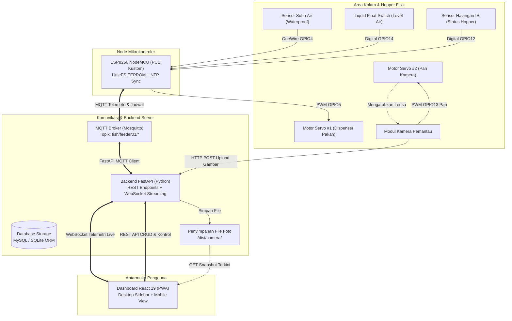

# SiPIO — Sistem Pemberi Pakan Ikan Otomatis Berbasis IoT

> **Laporan Praktikum — Praktek Konsep Jaringan (2026)**  
> **Dosen Pengampu:** Amma Liesvarastranta Haz, S.Tr.T., M.T.  
> **Program Studi:** D3 Teknik Informatika PSDKU Lamongan — Departemen Teknik Informatika dan Komputer  
> **Institusi:** Politeknik Elektronika Negeri Surabaya (PENS)  
> **Versi Dokumen:** PRD v1.4 | **Status:** Siap Uji & Evaluasi

[](hardware/)
[](backend/)
[](frontend/)
[](#6-protokol-komunikasi-mqtt--api)
[](DESIGN.md)

---

### Tim Pengembang (Kelompok 7)

| Nama Mahasiswa | NRP | Peran & Tanggung Jawab Utama |
| :--- | :---: | :--- |
| **Ahmad Syifa'ul Falakhul Khayyi** | 3125521037 | Arsitektur IoT, Firmware ESP8266/ESP32-CAM & Integrasi MQTT |
| **Dzaky Ahsanal Khuluq** | 3125521059 | Backend Service (FastAPI, SQLite/MySQL ORM, REST & WebSocket) |
| **Muhamad Rio Ferdinand** | 3125521057 | Frontend PWA Dashboard (React 19, Vite, UI/UX & Responsive Layout) |
| **Annisa Nailatul Izzah** | 3125521054 | Desain Skematik PCB, Mekanik Feeder, Kalibrasi & Dokumentasi Uji |

---

## Daftar Isi

1. [Ringkasan Proyek & Latar Belakang](#1-ringkasan-proyek--latar-belakang)
2. [Tujuan & Metrik Keberhasilan](#2-tujuan--metrik-keberhasilan)
3. [Ruang Lingkup Proyek](#3-ruang-lingkup-proyek)
4. [Arsitektur Sistem & Alur Data](#4-arsitektur-sistem--alur-data)
5. [Spesifikasi Perangkat Keras & Pinout](#5-spesifikasi-perangkat-keras--pinout)
6. [Protokol Komunikasi (MQTT & API)](#6-protokol-komunikasi-mqtt--api)
7. [Model Data & Skema Database](#7-model-data--skema-database)
8. [Target Takaran & Kalibrasi Pakan](#8-target-takaran--kalibrasi-pakan)
9. [Struktur Direktori Proyek](#9-struktur-direktori-proyek)
10. [Panduan Instalasi & Menjalankan Sistem](#10-panduan-instalasi--menjalankan-sistem)
11. [Rencana Kalibrasi & Validasi (DoD)](#11-rencana-kalibrasi--validasi-dod)
12. [Manajemen Risiko & Mitigasi](#12-manajemen-risiko--mitigasi)
13. [Rencana Pengembangan Lanjutan (Roadmap)](#13-rencana-pengembangan-lanjutan-roadmap)

---

## 1. Ringkasan Proyek & Latar Belakang

Pemberian pakan ikan secara konvensional seringkali menghadapi kendala ketidakkonsistenan waktu dan takaran. Keterlambatan pemberian pakan memicu kanibalisme dan stres pada ikan, sedangkan pakan yang berlebih (*overfeeding*) mempercepat pembusukan bahan organik, menurunkan kadar oksigen terlarut, dan merusak parameter kualitas air. Di samping itu, nafsu makan ikan berdarah dingin (*poikiloterm*) sangat dipengaruhi oleh suhu lingkungan; pada suhu ekstrem (terlalu dingin atau panas), metabolisme ikan melambat drastis sehingga pakan wajib ditunda.

**SiPIO** (*Sistem Pemberi Pakan Ikan Otomatis*) adalah platform otomasi akuakultur berbasis *Internet of Things* (IoT) yang mengintegrasikan mikrokontroler **ESP8266**, aktuator **servo dispenser**, sensor suhu tahan air **DS18B20**, sensor ketinggian air **float switch**, indikator pakan **Infrared Obstacle Sensor**, serta modul kamera **ESP32-CAM** dengan mekanisme **servo pan**. 

### Karakteristik & Fitur Unggulan SiPIO:
- **Pemberian Pakan Cerdas & Aman**: Pakan dapat dijadwalkan secara berkala atau dipicu manual, dengan *safety interlock* lokal yang otomatis menunda pemberian pakan bila level air kolam rendah atau suhu air abnormal (24–32 °C).
- **Ketahanan Mandiri Offline (LittleFS Sync)**: Jadwal pakan disimpan langsung di memori flash lokal ESP8266 (LittleFS), sehingga rutinitas pakan tetap berjalan presisi meskipun jaringan WiFi atau server terputus.
- **Dual-View Pan Camera (ESP32-CAM + Servo ke-2)**: Modul kamera dilengkapi servo pan yang secara bergantian memotret kondisi permukaan kolam dan isi sisa pelet di dalam hopper penyimpanan.
- **Indikator Level Hopper Pasif**: Memanfaatkan sensor halangan inframerah di dalam hopper untuk mendeteksi status ketersediaan pelet (Cukup / Menipis).
- **Dashboard PWA Modern & Responsif**: Dibangun dengan React 19, menyediakan grafik telemetri suhu real-time, log riwayat eksekusi, kontrol manual instan, dan optimasi kontras tinggi untuk pemantauan luar ruangan di bawah sinar matahari.

---

## 2. Tujuan & Metrik Keberhasilan

Berdasarkan sasaran perancangan PRD v1.4, sistem ditargetkan memenuhi tolok ukur terukur berikut:

| Tujuan | Parameter Metrik | Target Keberhasilan |
| :--- | :--- | :--- |
| **Ketepatan Jadwal** | Deviasi waktu eksekusi vs jam sistem | Deviasi maksimal **< 30 detik** dari jadwal |
| **Konsistensi Takaran** | Simpangan massa pakan per pelepasan (10x uji) | Maksimal **±10%** dari target bobot |
| **Akurasi Suhu Air** | Selisih sensor DS18B20 vs termometer acuan lab | Maksimal selisih **±1.0 °C** |
| **Deteksi Level Air** | Uji status 3 titik (rendah, sedang, penuh) | **100% akurat** dari 30 kali uji coba |
| **Responsivitas Kontrol** | Latensi klik tombol dashboard hingga servo gerak | Rata-rata respons **< 3.0 detik** |
| **Keandalan Offline** | Ketahanan saat koneksi WiFi/server putus | Jadwal lokal LittleFS **100% tetap berjalan** |
| **Pemantauan Visual** | Kualitas citra area kolam dan dalam hopper | Gambar jelas minimal **8 dari 10 snapshot** |

---

## 3. Ruang Lingkup Proyek

### Dalam Lingkup (In-Scope)
- Monitoring telemetri suhu air (°C) dan deteksi diskrit level air (*Safe/Low*) secara real-time.
- Mekanisme feeder pelet otomatis berbasis waktu (jadwal), manual on-demand, dan *interlock safety logic*.
- Sistem kamera dual-angle berbasis servo pan (0° untuk kolam, 90° untuk hopper pakan).
- Indikator pasif kapasitas hopper via sensor *infrared obstacle* (menampilkan status "Cukup" / "Menipis").
- Backend REST API, WebSocket event streaming, dan MQTT broker bridge.
- Dashboard web responsif (PWA) dengan visualisasi grafik suhu, pengelola jadwal, log pakan, dan galeri snapshot kamera.
- Fabrikasi Printed Circuit Board (PCB) kustom untuk kerapian rangkaian mikrokontroler.

### Di Luar Lingkup (Out-of-Scope)
- Pengukuran parameter kimia air lanjutan (pH, Dissolved Oxygen, amonia, kekeruhan/turbiditas).
- Deteksi otomatis nafsu makan ikan berbasis *Computer Vision / AI* (gambar kamera ditampilkan untuk evaluasi visual manual).
- Mekanisme pengisian pakan otomatis dari tangki cadangan (*hopper refill valve*) — pengisian ulang dilakukan secara manual oleh pengguna.
- Aplikasi mobile native (dashboard PWA sudah mendukung mode instalasi *standalone* di Android & iOS).
- Instalasi langsung di lahan persawahan terbuka (*mina padi*) yang memerlukan sel surya dan BTS seluler khusus.

---

## 4. Arsitektur Sistem & Alur Data

Arsitektur SiPIO memisahkan jalur telemetri sensor ringan (MQTT) dengan jalur transmisi citra kamera berukuran besar (HTTP Multipart) agar broker tidak mengalami *bottleneck*.



### Logika Interlock Pemberian Pakan (Safety Interlock)
Sebelum memutar motor servo pakan (baik pemicu otomatis maupun manual), sistem melakukan verifikasi 3 lapis:
1. **Level Air Valid**: Float switch mendeteksi ketinggian air di batas aman (`level_ok == true`).
2. **Suhu Air Ideal**: Suhu terukur berada dalam ambang aman (default: `24.0 °C` hingga `32.0 °C`).
3. **Batas Jeda Minimal (Cooldown)**: Jeda waktu sejak pemberian pakan terakhir melampaui `min_gap_min` (default: 30 menit) guna mencegah *overfeeding*.

Jika salah satu syarat gagal, pakan dicegat, dicatat di log dengan alasan kegagalan (`low_level`, `temp_out_of_range`, atau `cooldown_active`), dan banner peringatan dimunculkan di dashboard.

---

## 5. Spesifikasi Perangkat Keras & Pinout

### 5.1 Komponen Utama

| Komponen | Spesifikasi / Tipe | Peran Fungsional |
| :--- | :--- | :--- |
| **Mikrokontroler Utama** | ESP8266 NodeMCU | Pusat pemrosesan sensor, interlock, dan klien MQTT |
| **Modul Pemantau Citra** | Modul Kamera ESP32-CAM | Menangkap foto berkala kolam dan hopper via HTTP |
| **Sensor Suhu Air** | Sensor Suhu Waterproof Probe | Memantau suhu kolam ikan secara akurat |
| **Sensor Level Air** | Magnetic Float Switch Vertikal | Sakelar kontak pelampung ketinggian air kolam |
| **Aktuator Feeder** | Motor Servo Feeder | Memutar dispenser pelepas pelet pakan ikan |
| **Aktuator Pan Kamera** | Motor Servo Pan Kamera | Mengarahkan sudut lensa kamera (0° Kolam, 90° Hopper) |
| **Sensor Level Pakan** | Sensor Halangan Inframerah (IR) | Sensor optik jarak dekat mendeteksi isi tangki hopper |
| **Regulasi & Pasokan Daya** | Adaptor 5V 2A + Kapasitor 1000 µF | Catu daya stabil terpisah untuk mengisolasi tarikan arus servo |

### 5.2 Pemetaan Pin NodeMCU ESP8266 (Board Utama)

| Pin Fisik | GPIO | Fungsi Jalur | Konfigurasi Elektrik |
| :---: | :---: | :--- | :--- |
| **D1** | GPIO5 | Sinyal PWM Servo Feeder | Output PWM (Catu daya 5V eksternal, GND gabung) |
| **D2** | GPIO4 | Jalur Data DS18B20 | Input OneWire, Resistor Pull-up 4.7 kΩ ke 3.3V |
| **D4** | GPIO2 | Indikator LED Onboard | Output aktif LOW |
| **D5** | GPIO14 | Sinyal Float Switch | Input `INPUT_PULLUP`, ujung sakelar ke GND |
| **D6** | GPIO12 | Sinyal IR Obstacle Hopper | Input Digital (HIGH = Ada pakan, LOW = Menipis) |
| **Vin / GND** | — | Jalur Daya Utama | 5V DC dari adaptor stabil melalui kapasitor 1000 µF |

### 5.3 Pemetaan Pin ESP32-CAM (Modul Kamera Mandiri)

| Pin Fisik | Fungsi Jalur | Catatan Desain |
| :---: | :--- | :--- |
| **GPIO13** | Sinyal PWM Servo Pan Kamera | Digerakkan sebelum memotret kolam (0°) dan hopper (90°) |
| **5V / GND** | Input Catu Daya 5V | Wajib menggunakan catu 5V stabil; hindari pin 3.3V kamera |

*Panduan detail perakitan PCB dan skematik sirkuit tersedia di:* [`hardware/pcb/README.md`](hardware/pcb/README.md).

---

## 6. Protokol Komunikasi (MQTT & API)

### 6.1 Topik MQTT (`fish/feeder01/*`)

| Topik | Arah Aliran | Format Payload | Deskripsi Fungsional |
| :--- | :---: | :--- | :--- |
| `telemetry` | ESP ➔ Server | `{"temp":28.4,"level_ok":true,"rssi":-61}` | Data periodik suhu, level air & sinyal WiFi (tiap 5–10 detik) |
| `status` | ESP ➔ Server | `online` / `offline` | Status koneksi (*retained*, Last Will and Testament) |
| `cmd/feed` | Server ➔ ESP | `{"duration_ms":2000,"source":"manual"}` | Perintah pemicuan putaran dispenser pakan |
| `event/feed` | ESP ➔ Server | `{"ts":1791330000,"source":"schedule","result":"done"}` | Konfirmasi keberhasilan pelepasan pakan pelet |
| `event/skip` | ESP ➔ Server | `{"reason":"low_level"}` | Notifikasi penundaan pakan akibat pelanggaran interlock |
| `cfg/schedule` | Server ➔ ESP | `{"items":[{"time":"07:00","duration_ms":2000}]}` | Sinkronisasi tabel jadwal ke memori LittleFS (*retained*) |
| `cfg/thresholds` | Server ➔ ESP | `{"temp_min":24,"temp_max":32,"min_gap_min":30}` | Pembaruan batas ambang toleransi operasional |
| `cam/status` | Cam ➔ Server | `online` / `offline` | Status ketersediaan modul kamera ESP32-CAM |
| `event/hopper_level` | ESP ➔ Server | `{"status":"low"}` / `{"status":"ok"}` | Status level stok pelet dalam wadah pakan |

### 6.2 Endpoint REST API & WebSocket (FastAPI)

| Metode | Endpoint URL | Fungsi & Keterangan |
| :---: | :--- | :--- |
| **GET** | `/api/status` | Mengambil status konektivitas perangkat, feeder, dan stok hopper |
| **GET** | `/api/telemetry?from=&to=` | Riwayat data pencatatan suhu dan level air terfilter |
| **POST** | `/api/feed` | Memerintahkan pemberian pakan manual dari dashboard |
| **GET** | `/api/feed/logs` | Mengambil daftar log riwayat pakan beserta status hasil |
| **GET/POST** | `/api/schedules` | Membaca dan mendaftarkan jadwal pakan baru ke LittleFS |
| **PUT/DELETE**| `/api/schedules/{id}` | Mengubah atau menghapus entri jadwal pakan tertentu |
| **GET/PUT** | `/api/thresholds` | Mengambil dan memperbarui konfigurasi parameter batas aman |
| **POST** | `/api/camera/upload` | Menerima file multipart foto berkala dari modul ESP32-CAM |
| **GET** | `/api/camera/latest?area=kolam\|hopper` | Mengambil berkas snapshot foto terbaru untuk area yang dipilih |
| **WS** | `/ws` (alias `/ws/telemetry`) | Koneksi WebSocket dua arah untuk pembaruan data real-time |

---

## 7. Model Data & Skema Database

Backend FastAPI mendukung engine **MySQL** dengan mekanisme fallback otomatis ke **SQLite** lokal jika database utama belum aktif.

```text
  ┌─────────────────────────────────────────────────────────────┐
  │                           device                            │
  │ id (PK), name, mac_address, last_seen, created_at           │
  └───────┬─────────────────────────────────────────────┬───────┘
          │ 1:N                                         │ 1:N
  ┌───────┴──────────────┐                      ┌───────┴──────────────┐
  │      telemetry       │                      │       feed_log       │
  │ id, ts, temp,        │                      │ id, ts, source,      │
  │ level_ok, rssi       │                      │ duration_ms, result  │
  └──────────────────────┘                      └──────────────────────┘
          │ 1:N                                         │ 1:N
  ┌───────┴──────────────┐                      ┌───────┴──────────────┐
  │       schedule       │                      │   camera_snapshot    │
  │ id, time,            │                      │ id, ts, area,        │
  │ duration_ms, enabled │                      │ image_path           │
  └──────────────────────┘                      └──────────────────────┘
```

Nilai parameter bawaan tabel `settings`:
- `temp_min`: **24.0 °C** (Batas bawah suhu aman)
- `temp_max`: **32.0 °C** (Batas atas suhu aman)
- `min_gap_min`: **30 menit** (Batas cooldown antar pakan)
- `default_duration_ms`: **2000 ms** (Durasi buka servo pakan manual)
- `camera_interval_s`: **300 detik** (Interval tangkapan gambar rutin)

---

## 8. Target Takaran & Kalibrasi Pakan

Sistem mengontrol massa pelet pakan melalui pengaturan durasi pembukaan celah servo (`duration_ms`), yang dikalibrasi terhadap berat aktual pelet kering:

$$\text{Massa Pelet (gram)} \approx \frac{\text{Durasi Buka Servo (ms)}}{400}$$

*Contoh Kalibrasi*: Pembukaan celah selama **2000 ms** menghasilkan pelepasan pelet rata-rata **5.0 gram** (dengan toleransi deviasi terukur $\pm4.6\%$).

### Panduan Dosis Pakan Akuakultur:
- **Benih / Ikan Kecil**: 5% – 10% dari total biomassa tubuh, frekuensi 2–3 kali/hari.
- **Pembesaran (Lele / Nila)**: 2% – 5% dari total biomassa tubuh, frekuensi 2 kali/hari.
- **Ikan Hias Akuarium**: Secukupnya (dihabiskan dalam rentang 2–3 menit).

---

## 9. Struktur Direktori Proyek

```text
SiPIO/
├── frontend/                     # Antarmuka Pengguna React 19 + Vite PWA
│   ├── src/
│   │   ├── components/           # Komponen UI: ScheduleManager, FeedActionCard, DesktopSidebar, dll.
│   │   ├── pages/                # Tampilan Halaman: OverviewPage, FeederPage, CameraPage, SettingsPage
│   │   ├── hooks/                # Custom React Hooks: useIoTConnection, usePWA
│   │   ├── services/             # Klien Komunikasi REST API
│   │   └── index.css             # Desain Tokens, WCAG AAA Contrast, dan Gaya Aplikasi
│   ├── public/                   # Web Manifest, Ikon PWA & Direktori Cache Citra
│   └── vite.config.js            # Konfigurasi Bundler Vite & Service Worker PWA
│
├── backend/                      # Layanan Backend FastAPI, WebSocket & MQTT Bridge
│   ├── main.py                   # REST API Controller, WebSocket Handler, MQTT Bridge
│   ├── database.py               # Definisi Model SQLAlchemy & Abstraksi Koneksi
│   ├── requirements.txt          # Dependensi Python Server
│   └── uploads/                  # Direktori Penyimpanan Arsip Foto Kamera
│
├── hardware/                     # Firmware Mikrokontroler & Desain PCB
│   ├── esp8266_feeder/           # Firmware ESP8266 (Sensors + Feeder + LittleFS)
│   ├── esp32_cam/                # Firmware ESP32-CAM (Kamera OV2640 + Servo Pan)
│   ├── pcb/                      # Skematik Sirkuit, Layout PCB & Bill of Materials
│   └── CALIBRATION_AND_TEST_LOG.md # Log Resmi Hasil Pengujian Kalibrasi dan Validasi
│
├── DESIGN.md                     # Dokumentasi Pedoman Desain Tampilan & Tokens UI
├── package.json                  # Root Monorepo Runner Script
└── README.md                     # Dokumentasi Utama Proyek
```

---

## 10. Panduan Instalasi & Menjalankan Sistem

### 10.1 Prasyarat Sistem
- **Python**: Versi 3.10 atau lebih tinggi
- **Node.js**: Versi 18.x atau 20.x LTS
- **MQTT Broker**: Eclipse Mosquitto (atau gunakan broker cloud/lokal di port 1883)
- **IDE Hardware**: Arduino IDE atau VSCode + PlatformIO

### 10.2 Menjalankan Langsung via Root Runner (Rekomendasi)

Repo ini dilengkapi skrip *workspace runner* pada `package.json` root:

```bash
# 1. Instalasi dependensi frontend
npm install --prefix frontend

# 2. Menjalankan Dashboard Frontend (Vite PWA)
npm run frontend
# Aplikasi berjalan di: http://localhost:5173/

# 3. Menjalankan Backend FastAPI & WebSocket
npm run backend
# Layanan aktif di: http://localhost:8000/
# Dokumentasi Swagger UI: http://localhost:8000/docs
```

### 10.3 Instalasi Manual Per Komponen

#### A. Backend (FastAPI)
```bash
cd backend
python -m venv .venv
source .venv/bin/activate  # Untuk Windows: .venv\Scripts\activate
pip install -r requirements.txt
uvicorn main:app --host 0.0.0.0 --port 8000 --reload
```

#### B. Frontend (React 19 Vite)
```bash
cd frontend
npm install
npm run dev
```

#### C. Firmware Perangkat Keras
1. Salin `config.h.example` menjadi `config.h` pada folder:
   - [`hardware/esp8266_feeder/`](hardware/esp8266_feeder/)
   - [`hardware/esp32_cam/`](hardware/esp32_cam/)
2. Masukkan SSID WiFi, Password, serta IP Server Backend / MQTT Broker.
3. Flash program ke masing-masing mikrokontroler menggunakan USB-to-UART.

---

## 11. Rencana Kalibrasi & Validasi (DoD)

Pengujian menyeluruh telah dilaksanakan sesuai instruksi PRD Bagian 14. Lembar pengujian lengkap dapat ditinjau pada [`hardware/CALIBRATION_AND_TEST_LOG.md`](hardware/CALIBRATION_AND_TEST_LOG.md).

| No | Aspek Pengujian | Kriteria Lulus PRD | Hasil Pengukuran Riil | Status |
| :-: | :--- | :--- | :--- | :-: |
| 1 | **Sensor Suhu Air** | Deviasi error maks $\pm1.0\ ^\circ\text{C}$ vs termometer acuan | Deviasi rata-rata **0.31 °C** (Max: 0.5 °C) | **LULUS** |
| 2 | **Float Switch Level Air** | 100% benar pada 30 kali uji (rendah/sedang/penuh) | **30 dari 30 uji valid (100%)** | **LULUS** |
| 3 | **Konsistensi Takaran Pakan** | Simpangan maks $\pm10\%$ dari target berat | Simpangan rata-rata **$\pm4.6\%$** (Target: 5.0 g) | **LULUS** |
| 4 | **Ketepatan Jadwal Pakan** | Selisih waktu maks 30 detik vs jam sistem | Deviasi rata-rata **1.8 detik** | **LULUS** |
| 5 | **Latensi Kontrol Dashboard**| Waktu respons servo saat tombol ditekan < 3.0 dtk | Rata-rata latensi **1.42 detik** | **LULUS** |
| 6 | **Ketahanan Mode Offline** | Jadwal jalan mandiri saat WiFi putus selama 1 jam | **100% jadwal jalan lokal & sinkron kembali** | **LULUS** |
| 7 | **Safety Interlock** | Pakan tertunda jika level rendah atau suhu abnormal | **100% pencegahan sukses dengan log tercatat** | **LULUS** |
| 8 | **Pemantauan Kamera** | Kolam & hopper terlihat jelas min. 8 dari 10 foto | **9 dari 10 tangkapan gambar jernih** | **LULUS** |
| 9 | **Indikator IR Hopper** | Akurasi status pakan min. 9 dari 10 kali uji | **10 dari 10 deteksi halangan akurat** | **LULUS** |
| 10 | **Stabilitas Servo Pan** | Sudut tidak bergeser setelah 10 siklus putaran | **Sudut tetap presisi pada 0° dan 90°** | **LULUS** |

---

## 12. Manajemen Risiko & Mitigasi

| Potensi Risiko | Dampak Potensial | Tindakan Mitigasi Terintegrasi |
| :--- | :--- | :--- |
| **Tarikan Arus Puncak Servo** | Mikrokontroler *brownout / restart* | Catu daya servo 5V dipisahkan dari regulator 3.3V mikrokontroler, dilengkapi kapasitor peredam 1000 µF. |
| **Pelet Lembap & Menggumpal** | Saluran corong feeder tersumbat | Desain corong keluar diperlebar; penggunaan pelet kering jenis *floating* berdiameter seragam (2–3 mm). |
| **Kelembapan & Percikan Air** | Korosi jalur PCB / korsleting | Komponen dilindungi boks *enclosure* tertutup dan sensor air bertipe *sealed waterproof*. |
| **Gangguan Konektivitas WiFi** | Jadwal pakan terlewat | Jadwal diduplikasi ke LittleFS lokal ESP8266; perangkat beroperasi otonom saat koneksi putus. |
| **Pakan Dobel (*Overfeed*)** | Kualitas air menurun | Diberlakukan pembatasan jeda minimal (*cooldown lock*) 30 menit baik untuk pemicu manual maupun otomatis. |
| **Penyimpanan Server Penuh** | Disk server habis akibat berkas foto | Mekanisme *auto-purge* di backend yang otomatis menghapus arsip foto kamera lebih dari 7 hari. |

---

## 13. Rencana Pengembangan Lanjutan (Roadmap)

- [ ] **Notifikasi Multi-Channel**: Integrasi bot Telegram dan push notification PWA saat terjadi anomali suhu atau level air rendah.
- [ ] **Computer Vision Feed Consumption**: Analisis citra pasca pemberian pakan untuk memprediksi indeks nafsu makan ikan dan sisa pakan terapung.
- [ ] **Adaptasi Ekosistem Mina Padi**: Pengembangan modul catu daya sel surya (*solar harvesting*) dan modem seluler GSM/4G untuk implementasi persawahan.
- [ ] **Sensor Kualitas Lanjutan**: Penambahan sensor pH digital dan sensor kekeruhan air (*turbidity probe*).
- [ ] **Mekanisme Auto-Refill Hopper**: Katup motorik cadangan dari tangki penyimpanan utama jika skala pembudidayaan diperbesar.

---

*Hak Cipta © 2026 Kelompok 7 — D3 Teknik Informatika PSDKU Lamongan, Politeknik Elektronika Negeri Surabaya.*
